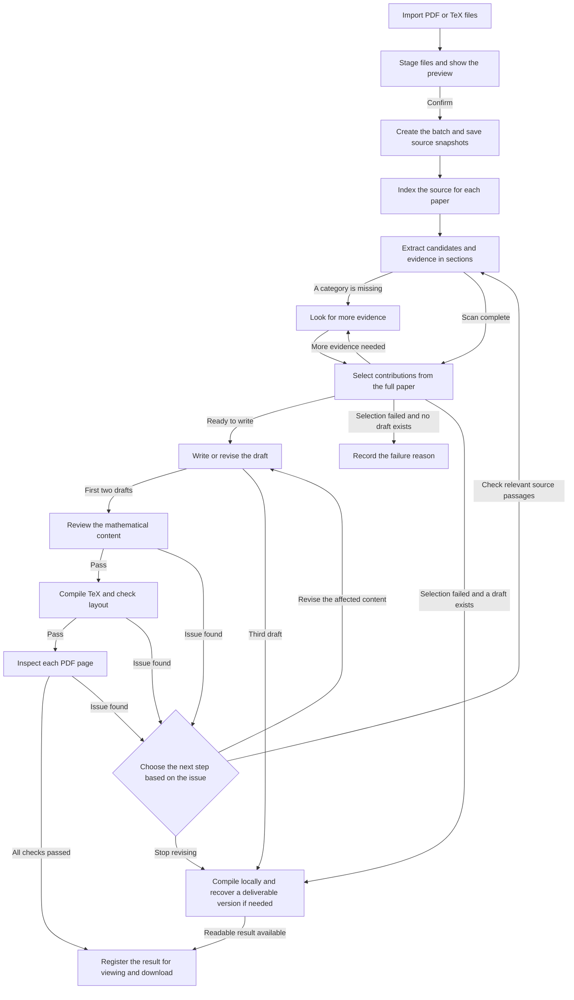
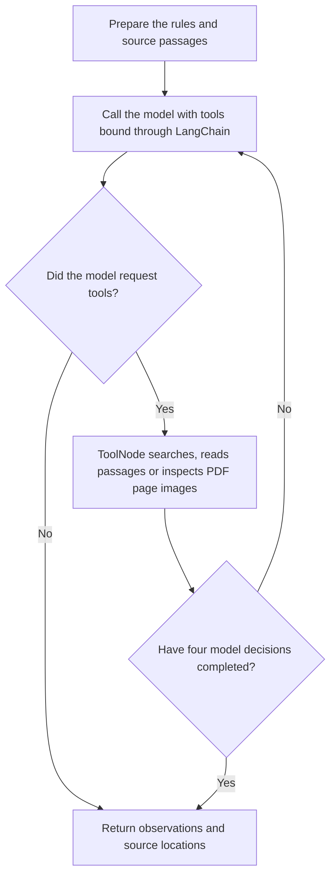

# Paper Extraction

[中文](README.md) · [Releases](https://github.com/ZhiyaoXiongMath/paper-extraction/releases)

A local workbench for mathematical papers. Import PDFs or TeX projects and get a selective English Introduction per paper, with source-grounded historical theorems, current contributions and definitions. The Chinese-language web interface links each generated statement to its source page or TeX lines.

## Install and run

Use Python 3.11–3.14 and TeX Live with `pdflatex` and `kpsewhich` on PATH. A full TeX Live installation includes the required packages. A minimal installation needs newtx, txfonts, amsmath, amsthm, mathrsfs, enumitem, needspace, microtype, etoolbox, hyperref, titlesec and their dependencies.

For a source checkout, install [uv](https://docs.astral.sh/uv/) and Node.js 22.12 or later. Build the web interface and install the locked Python dependencies:

```shell
git clone https://github.com/ZhiyaoXiongMath/paper-extraction.git
cd paper-extraction
npm --prefix frontend ci
npm --prefix frontend run build
uv sync --locked --python 3.12
uv run paper-extraction doctor
```

GitHub Releases lists versioned releases, release notes and any attached installers. If a release includes a `.whl` file, download it and install it inside a Python virtual environment. Use the downloaded filename in the command. The wheel includes the web interface.

```shell
python -m pip install paper_extraction-0.1.0-py3-none-any.whl
paper-extraction --version
paper-extraction example compactness
```

For a new installation, copy [.env.example](.env.example) to `.env` in your **launch directory** and set your `OPENAI_API_KEY`. For an existing installation, add this key to the existing file and set `PAPER_EXTRACTION_PROVIDER=openai`. The model settings page also supports DeepSeek and GLM. Environment variables are supported. Use `paper-extraction --env-file path/to/config serve` to select another file. Source passages and page images are sent to the selected provider.

```shell
paper-extraction doctor --live --provider openai
paper-extraction serve
```

Prefix these commands with `uv run` in a source checkout. Open **http://127.0.0.1:8765** in your browser. Use `serve --port 8766` for another port. Model Settings offers separate reasoning controls for supported text and vision models. The defaults are `medium` for supported OpenAI models, `high` for DeepSeek Flash, and `low` for GLM-5.3. GLM-4.6V has thinking enabled and manages its own effort. Each new batch records the selected settings, and connection tests use the saved settings for live requests.

## Process a batch

1. Choose files or a folder in the new-batch view. Inspect the preview and select the entry point for TeX packages with competing main files.
2. Select a provider and start. Two papers run concurrently by default. Closing the browser leaves the local worker active. Starting the service again resumes unfinished jobs.
3. Open a paper to read the generated content, examine its evidence and check the results. The TeX and PDF download buttons each show the file available for that drafting round. After a layout or visual check fails, you can download any readable PDF from the round to inspect the reported defect. The paper retains its failed status and can be retried individually.
4. A batch ZIP uses the batch name and groups each paper's PDF and self-contained TeX file in its own folder. Both single-paper and batch downloads name paper files after the input file with the suffix `-extraction`. For multi-file TeX projects, the selected main file supplies the name. The batch manifest includes pending, running and failed items.
5. Once every paper in a batch is paused or finished, you can delete that batch from the workbench or its detail view. Use “Clear finished batches” to remove batches where every paper has finished. Download any files you want to keep before confirming. Deletion removes the batch history, drafts and deliverables from the workbench.
6. Use the paper detail view to pause or resume a paper. Queued papers pause immediately. Running papers save a checkpoint when the current step finishes and resume from the following step.

**Example.** Import the [examples/compactness](examples/compactness) folder. One main file includes a separate chapter, illustrating how generated statements link to original source lines. This teaching manuscript presents the classical Arzelà–Ascoli theorem. The selected statements and their wording depend on the model run. A completed batch yields:

```text
001-compactness/
  main-extraction.tex
  main-extraction.pdf
manifest.json
```

## Workflow and acceptance

FastAPI handles imports and schedules work. Each paper runs in its own LangGraph graph with SQLite checkpoints. Extraction, writing and review call models through LangChain.



<details>
<summary>How evidence tools run</summary>

Extraction, some supplemental evidence searches and content reviews can invoke the evidence graph. Each invocation allows up to four model decisions, and each decision can request multiple read-only tools. Inspecting a PDF page image can call the vision model.



</details>

Each start or explicit retry can generate up to three drafts, including the first. The third draft goes straight to a two-pass compile and PDF readability check. For a TeX error, the workflow can restore a block tied to the same source evidence or deliver an earlier verified version. When neither is available, it compiles the existing content in a simplified layout. If the compiler is unavailable, it generates a readable PDF locally and labels it accordingly. Finalization uses no additional model calls. The workbench offers the PDF and the final TeX with its preamble embedded, and records whether the result passed all checks.

Each introduction includes a separate bibliography. The model selects current theorems, historical comparisons and necessary definitions from the source, and adds context where it helps explain the problem or the scope of the results. Aim for three body pages or fewer, with up to five when the material needs more space. Word counts guide the writing. The compiled checks enforce the measured block, formula and page budgets. The workbench reports missing source evidence and layout problems for each paper. [Original rules](src/paper_extraction/profile_assets/intro-rules-v13.txt)

## Configuration and development

| Setting | Purpose |
|---|---|
| `PAPER_EXTRACTION_PROVIDER` | Defaults to `openai`. Also accepts `deepseek` and `zhipu` |
| `OPENAI_API_KEY` / `DEEPSEEK_API_KEY` / `ZAI_API_KEY` | Your selected provider's API key |
| `OPENAI_TEXT_MODEL` / `OPENAI_VISION_MODEL` | OpenAI text and vision models, both default to `gpt-5.4-mini` |
| `DEEPSEEK_TEXT_MODEL` / `DEEPSEEK_VISION_MODEL` | DeepSeek text and image models, default `deepseek-flash` |
| `ZHIPU_TEXT_MODEL` / `ZHIPU_VISION_MODEL` | GLM text and image models, default `glm-5.3` / `glm-4.6v` |
| `OPENAI_BASE_URL` / `DEEPSEEK_BASE_URL` / `ZHIPU_BASE_URL` | Optional provider endpoint override |
| `PAPER_EXTRACTION_HOME` | Local data directory for source snapshots, checkpoints and artifacts. Defaults to the platform user-data directory |
| `PAPER_EXTRACTION_CONCURRENCY` | Number of papers processed concurrently. Defaults to 2 and accepts positive integers. A concurrency setting saved in the workbench takes precedence and applies immediately |
| `PAPER_EXTRACTION_MAX_IMPORT_FILES` | Files per upload, default 1000. Set to 0 for unlimited file count. Restart the service after changing it. Each PDF, TeX entry file, chapter or asset counts as one file |

Run `uv run pytest -q` and `npm --prefix frontend test`. To package, build the frontend and run `uv build --wheel`. The local FastAPI service serves API documentation at `/docs`. Offline model fixtures exercise execution paths; live model validation uses a separately configured account.

[MIT license](LICENSE). See [third-party notices](THIRD_PARTY.md).
