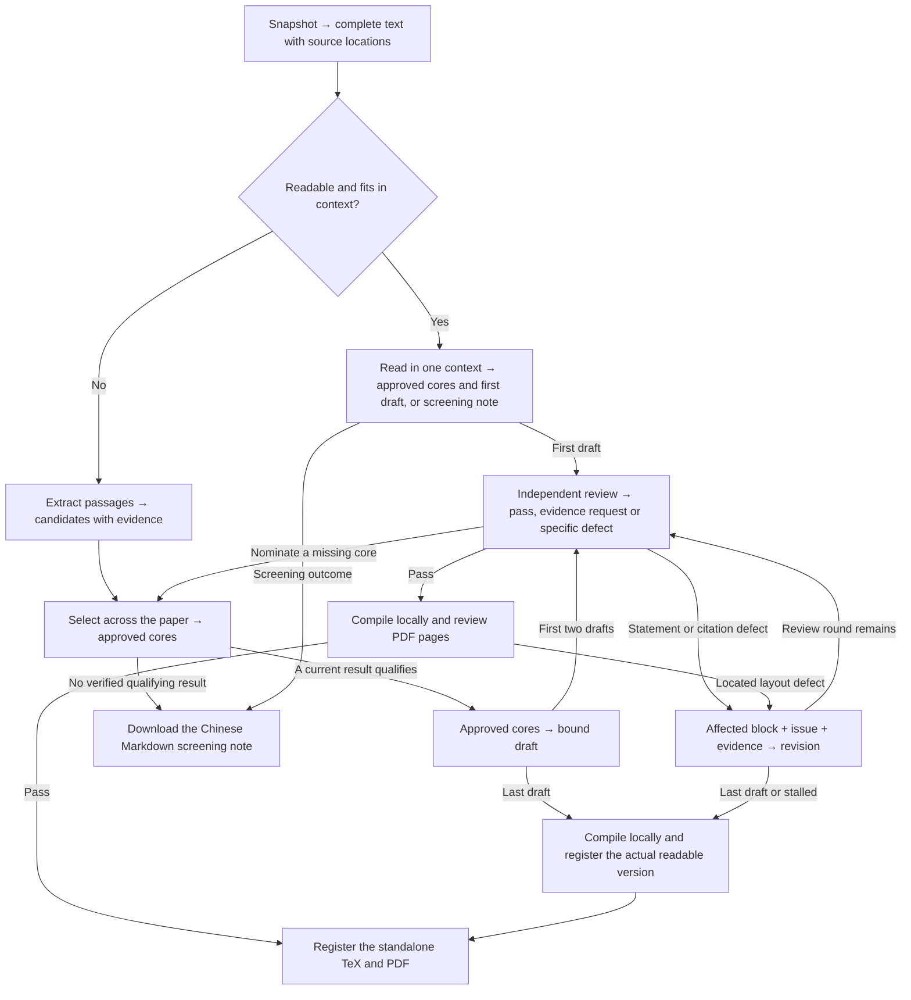

# Paper Extraction

[中文](README.md) · [Releases](https://github.com/ZhiyaoXiongMath/paper-extraction/releases)

**Paper Extraction is a local tool for extracting key content from mathematical research papers in batches.** Import PDFs or TeX projects to extract each paper’s research question, essential definitions, relevant prior theorems, and new results and applications. Use it to screen a group of papers, identify what each contributes, and return to the original for a closer read.

For a paper with a qualifying result of its own, the workbench produces an English mathematical introduction as a PDF and self-contained TeX source. Papers containing only background, classical special cases or proof steps receive a Chinese Markdown note explaining the screening decision. Both outputs point back to the source pages or TeX lines and can be downloaded individually or in a batch ZIP.

## Install and run

Use Python 3.11–3.14 and TeX Live with `pdflatex` and `kpsewhich` on PATH. A full TeX Live installation includes the required packages. A minimal installation needs newtx, txfonts, amsmath, amsthm, mathrsfs, enumitem, needspace, microtype, etoolbox, hyperref, titlesec and their dependencies.

For a source checkout, install [uv](https://docs.astral.sh/uv/) and Node.js 22.12 or later. Build the web interface and install the locked Python dependencies:

```shell
git clone https://github.com/ZhiyaoXiongMath/paper-extraction.git
cd paper-extraction
npm --prefix frontend ci
npm --prefix frontend run build
uv sync --locked --python 3.12
uv run paper-extraction doctor
```

GitHub Releases lists versioned releases, release notes and any attached installers. If a release includes a `.whl` file, download it and install it inside a Python virtual environment. Use the downloaded filename in the command. The wheel includes the web interface.

```shell
python -m pip install paper_extraction-0.1.0-py3-none-any.whl
paper-extraction --version
paper-extraction example compactness
```

For a new installation, copy [.env.example](.env.example) to `.env` in your **launch directory** and set your `OPENAI_API_KEY`. For an existing installation, add this key to the existing file and set `PAPER_EXTRACTION_PROVIDER=openai`. The model settings page also supports DeepSeek and GLM. Environment variables are supported. Use `paper-extraction --env-file path/to/config serve` to select another file. Source passages and page images are sent to the selected provider.

```shell
paper-extraction doctor --live --provider openai
paper-extraction serve
```

Prefix these commands with `uv run` in a source checkout. Open **http://127.0.0.1:8765** in your browser. Use `serve --port 8766` for another port. Model Settings offers separate reasoning controls for supported text and vision models. The defaults are `medium` for supported OpenAI models, `high` for DeepSeek Flash, and `low` for GLM-5.3. GLM-4.6V has thinking enabled and manages its own effort. Each new batch records the selected settings, and connection tests use the saved settings for live requests.

## Process a batch

1. Choose files or a folder in the new-batch view. Inspect the preview and select the entry point for TeX packages with competing main files.
2. Select a provider and start. Two papers run concurrently by default. Closing the browser leaves the local worker active. Starting the service again resumes unfinished jobs.
3. Open a paper and select a theorem to see its source evidence. “已交付” means the output is available to download. The “自动检查” tab lists the content, typesetting and page-by-page checks for the version delivered. If a technical problem interrupts a job, you can download its interruption report and retry that paper. Saved drafts offer the TeX or PDF available for the recorded round.
4. A batch ZIP uses the batch name and groups each paper's PDF and self-contained TeX file in its own folder. Both single-paper and batch downloads name paper files after the input file with the suffix `-extraction`. For multi-file TeX projects, the selected main file supplies the name. The batch manifest includes pending, running and failed items.
5. Once every paper in a batch is paused or finished, you can delete that batch from the workbench or its detail view. Use “Clear finished batches” to remove batches where every paper has finished. Download any files you want to keep before confirming. Deletion removes the batch history, drafts and deliverables from the workbench.
6. Use the paper detail view to pause or resume a paper. Queued papers pause immediately. Running papers save a checkpoint when the current step finishes and resume from the following step.

**Example.** Import the `examples/compactness` folder and select `main.tex` as its entry point. It includes a separate chapter presenting the classical Arzelà–Ascoli theorem. When the model finds only previously known results in this teaching manuscript, the batch ZIP contains the files below. [Example source](examples/compactness)

```text
001-compactness/
  main-extraction.md
manifest.json
```

If you import your own `geometry.tex` and the workbench identifies a qualifying contribution, the same download control provides `geometry-extraction.tex` and `geometry-extraction.pdf`. The TeX includes its preamble.

## Workflow and acceptance

FastAPI handles imports and schedules work. Each paper runs in its own LangGraph graph with SQLite checkpoints. Extraction, writing and review call models through LangChain.

New batches choose between a whole-paper read and segmented extraction using the complete request size and the model's capacity. The run log records the routing decision. In segmented extraction, each source question identifies a candidate, the condition to check and its location. The selector can retrieve full passages by ID. Per-request usage includes extraction and source checks before the first draft. Existing batches resume with their saved workflow revision.

Papers without a verified qualifying current result produce only a Chinese `input-name-extraction.md` screening note with source locations.



<details>
<summary>How source checks work</summary>

New batches review the admitted claims with their bound evidence. When the passages suffice, the reviewer returns a verdict or a specific correction directly. For an unresolved reading it identifies the question and location. The workbench retrieves the relevant text or sends the question with a PDF crop to the vision model and returns the extra evidence for that review. Pages without readable text can still be transcribed. Archived batches use the workflow and rules pinned at creation.

</details>

Each start or explicit retry can generate up to three drafts, including the first. The third draft goes straight to a two-pass compile and PDF readability check. For a TeX error, the workflow can restore a block tied to the same source evidence or deliver an earlier verified version. When neither is available, it compiles the existing content in a simplified layout. If the compiler is unavailable, it generates a readable PDF locally and labels it accordingly. Finalization uses no additional model calls. The workbench offers the PDF and the final TeX with its preamble embedded, and records whether the result passed all checks.

Each new batch pins its rules, node instructions and typesetting resources. Selection considers the whole paper. Only statements explicitly labeled *Theorem* or *Corollary* in the source qualify as current main results. Under rule B1, one or two results suffice when they represent the paper’s central contributions. The usual target is at most four. For each fifth or later result retained, the selection rationale must identify the distinct central contribution or substantial independent application that would otherwise be lost. Propositions and lemmas may supply assumptions, definitions and evidence. Directly relevant historical theorems supported by the source count separately, from zero to three. [Extraction rules](src/paper_extraction/profiles/core_selection_20261119/rules.txt) · [Node instructions](src/paper_extraction/profiles/core_selection_20261119/prompt.txt)

The introduction aims for three body pages or fewer, with up to five when needed and a separate bibliography page. Word counts guide the writing. After compilation, the workbench checks block heights, formulas and page counts.

## Configuration and development

| Setting | Purpose |
|---|---|
| `PAPER_EXTRACTION_PROVIDER` | Defaults to `openai`. Also accepts `deepseek` and `zhipu` |
| `OPENAI_API_KEY` / `DEEPSEEK_API_KEY` / `ZAI_API_KEY` | Your selected provider's API key |
| `OPENAI_TEXT_MODEL` / `OPENAI_VISION_MODEL` | OpenAI text and vision models, both default to `gpt-5.4-mini` |
| `DEEPSEEK_TEXT_MODEL` / `DEEPSEEK_VISION_MODEL` | DeepSeek text and image models, default `deepseek-flash` |
| `ZHIPU_TEXT_MODEL` / `ZHIPU_VISION_MODEL` | GLM text and image models, default `glm-5.3` / `glm-4.6v` |
| `OPENAI_BASE_URL` / `DEEPSEEK_BASE_URL` / `ZHIPU_BASE_URL` | Optional provider endpoint override |
| `PAPER_EXTRACTION_HOME` | Local data directory for source snapshots, checkpoints and artifacts. Defaults to the platform user-data directory |
| `PAPER_EXTRACTION_CONCURRENCY` | Number of papers processed concurrently. Defaults to 2 and accepts positive integers. A concurrency setting saved in the workbench takes precedence and applies immediately |
| `PAPER_EXTRACTION_MAX_IMPORT_FILES` | Files per upload, default 1000. Set to 0 for unlimited file count. Restart the service after changing it. Each PDF, TeX entry file, chapter or asset counts as one file |

Run `uv run pytest -q` and `npm --prefix frontend test`. To package, build the frontend and run `uv build --wheel`. The local FastAPI service serves API documentation at `/docs`. Offline model fixtures exercise execution paths; live model validation uses a separately configured account.

[MIT license](LICENSE). See [third-party notices](THIRD_PARTY.md).
