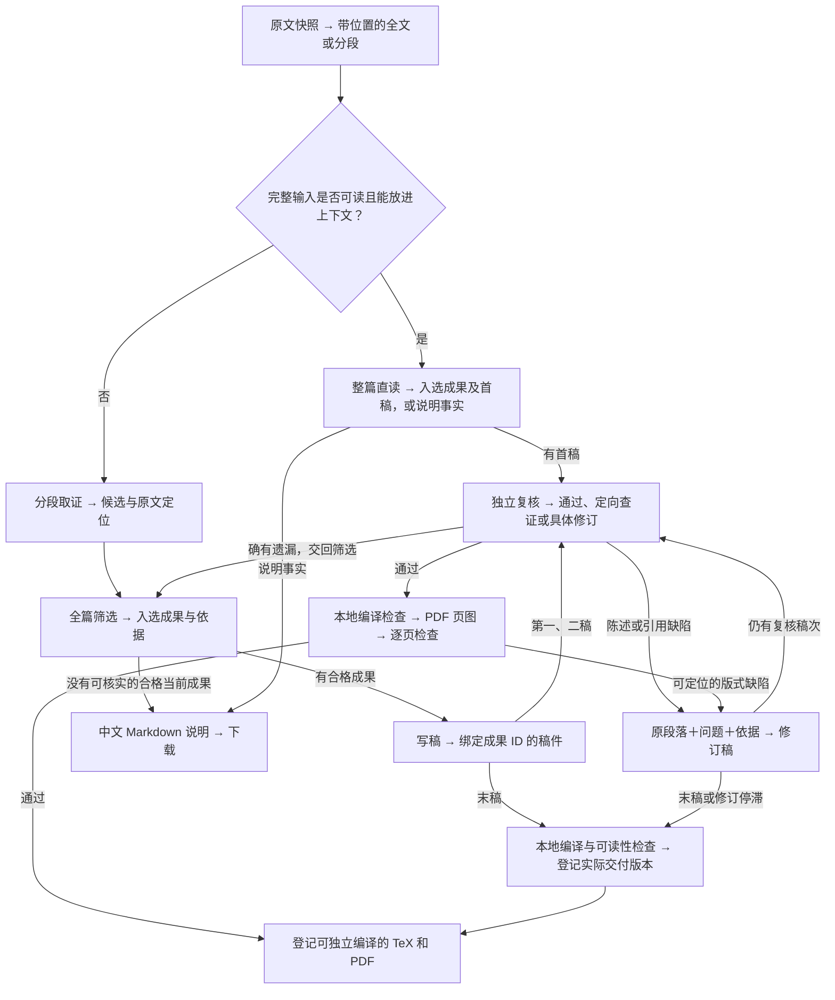

# Paper Extraction

[English](README.en.md) · [GitHub 发布页](https://github.com/ZhiyaoXiongMath/paper-extraction/releases)

**Paper Extraction 是一个批量提取数学论文核心内容的本地工具。** 导入一批 PDF 或 TeX，提取每篇论文的研究问题、必要定义、相关的既有定理、新成果及其应用。你可以用它筛读一组论文，快速了解各篇贡献，再回到原文细读。

对有合格当前成果的论文，工作台生成英文数学引言，提供 PDF 和可独立编译的 TeX。只有背景、经典特例或证明步骤的论文会得到一份中文 Markdown 说明，列明筛选依据。两种结果都可追溯到原文页码或 TeX 源文件行号，并可逐篇下载或打包下载。

## 安装和启动

需要 Python 3.11–3.14 及可运行 `pdflatex`、`kpsewhich` 的 TeX Live。完整的 TeX Live 安装包含所需宏包。精简安装须包含 newtx、txfonts、amsmath、amsthm、mathrsfs、enumitem、needspace、microtype、etoolbox、hyperref、titlesec 及依赖。

从仓库运行需安装 [uv](https://docs.astral.sh/uv/) 和 Node.js 22.12 或更新版。使用以下命令构建网页并安装锁定的 Python 依赖：

```shell
git clone https://github.com/ZhiyaoXiongMath/paper-extraction.git
cd paper-extraction
npm --prefix frontend ci
npm --prefix frontend run build
uv sync --locked --python 3.12
uv run paper-extraction doctor
```

GitHub 发布页提供带版本号的发布记录、更新说明，以及随版本上传的安装包。如果所选版本附有 `.whl`，下载后在 Python 虚拟环境中安装，命令中的文件名以实际下载为准。安装包内置网页。

```shell
python -m pip install paper_extraction-0.1.0-py3-none-any.whl
paper-extraction --version
paper-extraction example compactness
```

首次运行时，把 [.env.example](.env.example) 复制到**启动目录**并命名为 `.env`。默认使用 OpenAI，填写自己的 `OPENAI_API_KEY`。已有配置文件时，在原文件中添加该变量并设置 `PAPER_EXTRACTION_PROVIDER=openai`。DeepSeek 和智谱也可在网页的模型设置中选择。环境变量同样有效。若配置文件在其他位置，请用 `paper-extraction --env-file 配置路径 serve`。论文片段和需要识别的页图会发送给选定的模型服务。

```shell
paper-extraction doctor --live --provider openai
paper-extraction serve
```

从源码安装时在上述命令前加 `uv run`。用浏览器打开 **http://127.0.0.1:8765**。可用 `serve --port 8766` 更换端口。在“模型设置”中，可按服务商分别保存模型支持的文本和视觉推理档位。OpenAI 支持档位时默认使用 `medium`，DeepSeek Flash 默认使用 `high`，GLM-5.3 默认使用 `low`。GLM-4.6V 启用思考，由模型控制推理强度。新批次记录当时的设置，连接测试使用已保存的档位发起真实模型请求。

## 一次提取

1. 在“新建批次”选择多个文件或整个论文目录，核对预览清单，为有多个入口的 TeX 包选择主文件。
2. 选择模型并开始提取。默认并发两篇。关闭网页后后端继续工作；重新启动服务时恢复未完成任务。
3. 打开单篇详情，点击定理可查看原文依据。“已交付”表示成品已可下载。“自动检查”页签分别列出交付稿的内容、编译排版和逐页检查结果。若任务因技术问题中断，可下载中断记录并单独重试。有已保存草稿时，可按稿次下载相应的 TeX 或 PDF。
4. 批次 ZIP 以批次名命名，每篇论文的 PDF 和可独立编译的 TeX 放在各自的目录里。单篇和批次下载中的论文文件均以输入文件名加 `-extraction` 命名。多文件 TeX 项目使用所选主文件名。批次清单也会列出排队、失败或仍在处理的项目。
5. 当批次中的每篇论文都已暂停或结束，可以在工作台或批次详情单独删除该批次。“清除已结束批次”用于批量清除所有论文均已结束的批次。确认后，批次记录、草稿和成品会一并移除。请先下载需要保留的文件。
6. 论文详情提供“暂停提取”和“继续提取”。排队中的任务立即暂停。运行中的任务在当前环节完成后保存检查点，继续时从下一环节接着处理。

**示例。** 导入 `examples/compactness` 文件夹，以 `main.tex` 为入口。它引用另一份章节文件，内容是经典 Arzelà–Ascoli 定理。模型若确认这份教学材料只陈述既有结果，批次 ZIP 中会有以下文件。[示例源码](examples/compactness)

```text
001-compactness/
  main-extraction.md
manifest.json
```

若导入自己的 `geometry.tex` 并筛选出合格的当前成果，同一下载入口会提供 `geometry-extraction.tex` 和 `geometry-extraction.pdf`。TeX 已内嵌导言区。

## 工作流与判定

FastAPI 负责导入和调度。每篇论文独立运行一张 LangGraph 图，进度保存在 SQLite 中。提取、写稿和复核通过 LangChain 调用模型。

新批次按完整请求和模型容量选择整篇直写或分段提取。运行记录显示分流原因。分段中的疑点关联具体候选、条件和原文位置；筛选可以按 ID 调回完整原段。用量按实际请求记录，包含首次写稿之前的提取和补查。已建批次按保存的流程版本续跑。

无合格当前定理时，系统只交付中文 `原文件名-extraction.md`，说明筛选结论并列出依据。



<details>
<summary>复核怎样按需查证</summary>

新批次的复核请求附带已入选的陈述、已绑定原文及所需上下文。证据足够时直接返回通过或具体问题；有疑点时给出问题和定位，程序定向检索原文、读取源段，或把问题与 PDF 页图一起送给视觉模型。额外阅读后用同一问题和新增证据收束复核。无文字层的页面保留转写。较早批次使用其创建时的工具循环与规则。

</details>

每次启动或主动重试最多写三稿，包含初稿。第三稿直接双遍编译并确认 PDF 可以打开。若 TeX 编译报错，程序尝试复用原文依据相同的上一稿段落修复，或交付此前经验证的整稿。没有可复用版本时，程序用已有内容编译简明版。本机缺少编译环境时生成可读 PDF 并注明来源。定稿阶段无需再次调用模型。工作台提供 PDF 和内嵌前导内容的成品 TeX，并记录成品是否通过全部检查。

每个新批次固定提取规则、节点提示和排版资源。整篇筛选仅从原文明确标为定理或推论的结果中选主成果。按 B1，若一两项足以代表全文贡献，就只选这些，通常最多四项。保留第五项及以后的结果时，筛选理由须逐项说明省略它会漏掉哪一项独立的核心贡献或实质应用。命题和引理可以提供假设、定义与证据。直接相关且有原文依据的历史定理另计，最多三条，也可以为零。[现行提取规则](src/paper_extraction/profiles/core_selection_20261119/rules.txt) · [节点提示](src/paper_extraction/profiles/core_selection_20261119/prompt.txt)

正文通常以三页内为目标，确有需要时最多五页，参考文献另起一页。词数指导写作，程序在编译后检查块高、公式和页数。

## 配置与开发

| 配置 | 作用 |
|---|---|
| `PAPER_EXTRACTION_PROVIDER` | 默认 `openai`，可选 `deepseek`、`zhipu` |
| `OPENAI_API_KEY` / `DEEPSEEK_API_KEY` / `ZAI_API_KEY` | 所选服务商的独立 API 密钥 |
| `OPENAI_TEXT_MODEL` / `OPENAI_VISION_MODEL` | OpenAI 文本与看图模型，均默认 `gpt-5.4-mini` |
| `DEEPSEEK_TEXT_MODEL` / `DEEPSEEK_VISION_MODEL` | DeepSeek 文本及图像模型，默认 `deepseek-flash` |
| `ZHIPU_TEXT_MODEL` / `ZHIPU_VISION_MODEL` | 智谱文本及图像模型，默认 `glm-5.3` / `glm-4.6v` |
| `OPENAI_BASE_URL` / `DEEPSEEK_BASE_URL` / `ZHIPU_BASE_URL` | 对应模型服务的 API 地址 |
| `PAPER_EXTRACTION_HOME` | 本机论文快照、成品和任务数据库目录，默认使用平台用户数据目录 |
| `PAPER_EXTRACTION_CONCURRENCY` | 同时处理的论文数量，默认 2，可填正整数。工作台保存的并发设置优先，并立即生效 |
| `PAPER_EXTRACTION_MAX_IMPORT_FILES` | 单次上传的文件数，默认 1000，填 0 表示不限文件数。修改后重启服务。每个 PDF、TeX 主文件、章节和附件各计一个文件 |

测试运行 `uv run pytest -q` 和 `npm --prefix frontend test`。生成安装包先构建网页，再运行 `uv build --wheel`。FastAPI 接口说明位于本地服务的 `/docs`。测试中的模型回放用于验证执行路径，真实模型验收使用独立配置。

项目采用 [MIT 许可证](LICENSE)。第三方组件见[许可说明](THIRD_PARTY.md)。
